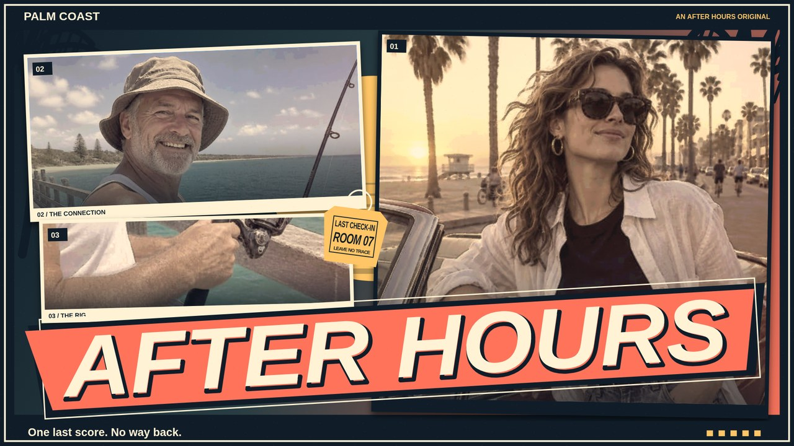

# After Hours — independent cover studio

[](https://make.fun/c/gta6-cover-art-01)
[](https://make.fun/c/gta6-cover-art-01)
[](https://make.fun/c/gta6-cover-art-01)

A private, offline photo-to-cover-art maker. Three independently framed photographs, a diagonal title ribbon, printed-ink treatment and a motel-key story stamp. No game logos, artwork, characters or fonts.



## Use it

Run `node serve.ts` with Node 22.18 or newer. Open `http://localhost:8080` in desktop Chrome. No install, build step, account or API key is needed.

1. Start with the two local kit samples, or choose **Add your photos**. JPG, PNG, WebP and AVIF images are decoded on your device; nothing is uploaded.
2. Select Hero, Snapshot or Detail. Assign a photo, drag within a panel, or use its zoom and horizontal/vertical sliders. One photo can fill all three panels while keeping crops independent.
3. Edit the title, caption, location and key tag. Try three layouts, three photographic color grades and clean/printed texture. **Coral hour** warms highlights; **Neon tide** casts rose and violet into the photographs, not just the title ribbon.
4. Choose landscape 1920 × 1080, square 1080 × 1080 or portrait 1080 × 1350. **Export PNG** downloads the exact preview at full resolution. The confirmation says when the PNG is ready and the download has started.

The live canvas and exported PNG use the same renderer. `View cover only` opens a native, keyboard-dismissable dialog. Inputs have visible keyboard focus and the layout works down to 320 CSS pixels without horizontal page overflow.

All scripts, images and fonts used by the application live under `app/`. The badges in this README are not application resources and do not load when the editor runs. No dependencies are shipped or required by the app or entrypoint.

## Deliverable

`main.ts` copies `app/` and `screenshots/` to `MAKEFUN_OUTPUT_DIR` (default `/output`) and writes `dossier.json` with the unchanged official `vendor/makefun-app.ts` helper. It rejects a screenshot directory that does not contain three or four PNG/JPEG files.

```
MAKEFUN_OUTPUT_DIR=.qa/output-a node main.ts
MAKEFUN_OUTPUT_DIR=.qa/output-b node main.ts
diff -r .qa/output-a .qa/output-b
cmp .qa/output-a/dossier.json .qa/output-b/dossier.json
node tests/audit.mjs .qa/output-a
git diff --check
```

Screenshots are four images produced by `tests/capture.py`: three actual downloaded PNGs, only scaled and JPEG-encoded within the competition limits, and one unaltered 1280 × 960 browser capture with the cover, photo controls and export button visible. The audit compares the output app and screenshot byte contents with their sources before rebuilding the dossier. The full-resolution originals and test evidence remain locally under ignored `.qa/`.

## Verification

The application has no test dependency. Browser QA tooling is separate and not delivered in `app/`:

```
python3 -m pip install --target .qa/python playwright --break-system-packages
npm install --prefix .qa/axe axe-core --ignore-scripts --no-audit --no-fund
node --test tests/*.test.mjs
python3 tests/browser_smoke.py
python3 tests/browser_flow.py
python3 tests/accessibility.py
python3 tests/capture.py
```

Python QA also uses Pillow, and launches the installed `/usr/bin/google-chrome` headlessly. Start `node serve.ts` before browser checks. The flow checks real local file input, corrupt-file recovery, crop independence, dragging, all layouts and grades, downloads at all three dimensions, keyboard focus, dialog Escape, offline operation, local resource responses and five responsive viewport widths. Axe is loaded only by the test runner, never by the app. Automated checks are not a claim of complete assistive-technology coverage.

## Assets and license

- App code: MIT, root `LICENSE` unchanged from kit.
- `app/samples/boulevard.jpg` and `pier.jpg`: official make.fun sample images, AI-generated and free to use under the kit rules. No personal photos are included.
- `app/fonts/LiberationSans-*.ttf`: unmodified Liberation Sans, SIL Open Font License 1.1; copyright and full license accompany the files in `app/fonts/LICENSE.txt`. No game font files are used.
- `vendor/makefun-app.ts`: unchanged official kit helper.

See [local verification](VERIFICATION.md) for results and limits. No server score, submission or paid placement is claimed.
